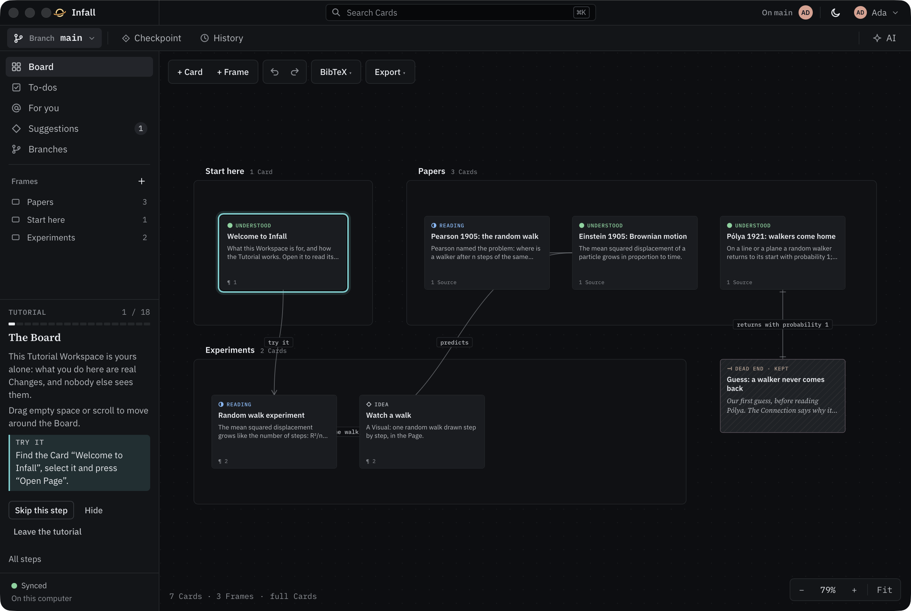

# Infall

Infall is a workspace where a researcher, or a small research team, lays out a project on a Board: Cards for topics, questions and findings, Connections between them, and Frames around the parts that belong together. Each Card opens into a Page with text, formulas, Sources (papers with their PDFs) and Runs (experiment code with the output it last produced). Every edit is kept in History; a different direction is tried on a Branch and brought back with a Merge, and work can stay in a Local Workspace on one computer or be shared in a Team Workspace on a server the team runs.



## Who it is for

- **A researcher working alone**, who wants the state of a project (what is known, what is open, what was tried and dropped, which papers say what) in one place on their own computer, with no account and no server.
- **A small research team or a lab**, a handful of Members who share one Board on a server they run themselves, each from the desktop app or a browser.

The words above are used in one sense only, everywhere in Infall and in these docs: [CONTEXT.md](CONTEXT.md).

## Status

Version **0.9.0, a pre-release.** Infall works and is used on macOS; it has not yet been used by anyone outside the people who build it. What has been seen working where:

| System | State |
|---|---|
| **macOS** (Apple silicon, macOS 11 or newer) | Built, packaged and used by hand. Its test suites pass. Not every screen added since 0.1.0 has been checked by hand in the packaged app yet ([the release checklist](docs/specs/release.md#8-before-handing-out-a-release-m13)). |
| **Ubuntu** 22.04 and 24.04 | Run only in containers with a virtual display, not on a real desktop. The arm64 package was installed and driven by hand there ([release.md §9.1](docs/specs/release.md#91-ubuntu-in-a-container)); the continuous build installs both packages (amd64, arm64) in clean containers, starts them with no network and opens a Tutorial Workspace. |
| **Windows** 10 and 11, 64-bit | Compiles, its tests run in the continuous build, and its installer is built. **Infall has never been started on Windows.** |
| **Team server** (Linux, container or systemd) | Rehearsed in containers on one Mac against `localhost`; not yet installed by someone outside the project from the docs alone. |

The builds are **not signed** by Apple or Microsoft, and the apps **update themselves** from this repository's releases (a version installed before 28 November 2026 does not: download it once more). They follow published versions; **Infall → Get beta builds** follows every change to `main` instead. What is left before 1.0: [the plan](docs/plans/2026-11-24-road-to-1.0.md). What changed: [CHANGELOG.md](CHANGELOG.md).

## Install from a release

Download the file for your system from the [Releases page](https://github.com/egorivlev/infall/releases), together with `SHA256SUMS`.

| System | File |
|---|---|
| macOS, Apple silicon | `Infall-<version>-arm64.dmg` |
| macOS, Intel | `Infall-<version>-x64.dmg` (built, never opened) |
| Windows 10 or 11, 64-bit | `Infall-<version>-x64-setup.exe` |
| Ubuntu 22.04 or 24.04, Intel/AMD | `infall_<version>_amd64.deb` |
| Ubuntu 22.04 or 24.04, ARM | `infall_<version>_arm64.deb` |

### Check the download

The builds are unsigned, so the SHA-256 is what ties the file you have to the one the release built. Compare what this prints with the file's line in `SHA256SUMS` (also in the release notes):

```sh
shasum -a 256 ~/Downloads/Infall-<version>-arm64.dmg           # macOS
sha256sum --check --ignore-missing SHA256SUMS                   # Ubuntu, in the folder with both files
```

```powershell
Get-FileHash .\Infall-<version>-x64-setup.exe                   # Windows (PowerShell)
```

If they differ, do not open the file.

### macOS

1. Open the `.dmg` and drag **Infall** onto **Applications**.
2. Open Infall. macOS refuses the first time, saying it could not verify Infall: Apple has not checked it, because nobody pays for the account that would let it. Click **Done**, then do one of these:
   - **macOS 15 and newer**: Apple menu › **System Settings** › **Privacy & Security**, scroll down to **Security**, click **Open Anyway** next to the line about Infall, and confirm with your password or Touch ID. The button stays for about an hour after you tried to open the app.
   - **macOS 14 and older**: Control-click (or right-click) Infall in Applications, choose **Open**, then **Open** again.
   - **Or, in Terminal**, remove the mark macOS puts on downloaded files, then open Infall normally:
     ```sh
     xattr -dr com.apple.quarantine /Applications/Infall.app
     ```
3. This is needed once per installed version. If macOS says Infall "is damaged", the file changed on the way: download it again and compare the SHA-256.

The app is signed ad hoc, which only lets it start on Apple silicon; it says nothing about who made it. More on what the warning means: [desktop/README.md](desktop/README.md#the-first-start-allowing-infall-once).

### Windows

1. Open `Infall-<version>-x64-setup.exe`. Windows shows a blue window, **Windows protected your PC**. Click **More info**, then **Run anyway**. (Edge may first say the file "isn't commonly downloaded"; keep it from the menu next to that message.)
2. The installer installs for you only, with no administrator rights, and offers to open Infall. It needs Microsoft's WebView2, which Windows 11 has and an updated Windows 10 normally has; the installer says so if it is missing.

If **Smart App Control** blocks the file instead, there is no way past it for an unsigned program; please [open an issue](https://github.com/egorivlev/infall/issues) saying so. Remember that nobody has seen Infall start on Windows yet: an issue saying what happened, working or not, helps. Details: [desktop/README.md](desktop/README.md#installing-it-on-windows-for-a-member).

### Ubuntu

```sh
cd ~/Downloads
sudo apt install ./infall_<version>_amd64.deb    # the ./ matters
```

Then open **Infall** from the applications overview, or run `infall`. The package is not signed and comes from no apt repository. `sudo apt remove infall` removes it and leaves your Workspaces. Details: [desktop/README.md](desktop/README.md#installing-it-on-ubuntu-for-a-member).

### First start

Infall opens on its start screen. **Tutorial** under **Create a workspace** makes a Tutorial Workspace on your computer and walks through every part of Infall in about fifteen minutes; no server, account or network is needed. To join a team, enter the address your Admin gives you under **Sign in to a Team Workspace**.

## Build from source

You need:

- **Rust 1.96** (the version the continuous build and the packages use; the desktop app declares 1.90 as its oldest) — [rustup.rs](https://rustup.rs)
- **Node.js 22.12 or newer** (or 20.19 or newer) with npm
- A C compiler for SQLite and AWS-LC, which are compiled into the server; no cmake or nasm:
  - macOS: the Xcode Command Line Tools (`xcode-select --install`)
  - Ubuntu: `sudo apt install build-essential pkg-config libwebkit2gtk-4.1-dev libjavascriptcoregtk-4.1-dev libsoup-3.0-dev libgtk-3-dev libdbus-1-dev`
  - Windows: [Tauri's prerequisites](https://v2.tauri.app/start/prerequisites/) (Microsoft's C++ build tools and WebView2)

The desktop app carries the web UI, so build that first, then run the app:

```sh
git clone https://github.com/egorivlev/infall.git
cd infall
npm --prefix web ci
npm --prefix web run build
cd desktop/src-tauri
cargo run
```

A release build of the app (its own files served from inside the program): `cargo build --release --features custom-protocol` in `desktop/src-tauri`. The installers are made by `scripts/package-macos.sh` (on a Mac), `scripts/package-linux.sh` (needs only Docker) and `scripts/package-windows.sh` (on a Mac or Linux, cross-compiling); each prints the SHA-256 of what it built. What each needs and checks: [desktop/README.md](desktop/README.md).

To work on the server and the web UI in a browser instead:

```sh
sh scripts/dev-server.sh          # API on http://localhost:8787, database in .dev/
npm --prefix web run dev          # in a second terminal: http://localhost:5173
```

The first run creates an Admin `admin@infall.test`, with its generated password in `.dev/admin-password`. How to run the tests, and what a change needs before it is merged: [CONTRIBUTING.md](CONTRIBUTING.md).

## Run a Team server

A Team server holds one Team Workspace for several Members. The container route is one `compose.yaml` with HTTPS from one domain setting and daily backups; the image is `ghcr.io/egorivlev/infall`. A systemd route is described beside it. Both: [deploy/README.md](deploy/README.md), then [deploy/harden.md](deploy/harden.md). For the people you invite: [docs/first-day.md](docs/first-day.md).

A Local Workspace can be moved onto an empty Team server later, and an Admin can take a Team Workspace off its server as one Workspace file ([the tutorial, part 14](docs/tutorial.md#14-from-alone-to-a-team)).

## AI

No model ships with Infall, and Infall has no AI account of its own. A Member who wants AI connects their own:

- **In the desktop app**, the AI sidebar runs on the Member's own Claude Code, under their own login and subscription.
- **In a browser** (and optionally in the app), a Member adds their own OpenRouter key; the server stores it encrypted and sends the question there.
- **Any AI app that speaks MCP** can be given an access token to read the Board and propose Suggestions as that Member.

An AI can read Research Content and propose Sources and Connections as Suggestions; it never changes Research Content itself. A Member accepts a Suggestion, or Pins an answer into a Page, where it is marked as AI-generated until a Member marks it reviewed. Without any of the three, Infall works the same with no AI. Why it is built this way: [ADR 0003](docs/adr/0003-ai-through-subscriptions-and-a-shared-tool-layer.md).

## What Infall talks to

The Workspace's own server (in a Local Workspace, the one inside the app); the AI only once a Member has set it up and uses it; Crossref or arXiv only when **Look up** or **Fetch the PDF from arXiv** is pressed. No analytics, no crash reports. The desktop app asks GitHub whether there is a newer release, at most once a day (every five minutes with beta builds). The full list: [docs/privacy.md](docs/privacy.md).

## Documentation

| | |
|---|---|
| [docs/tutorial.md](docs/tutorial.md) | Every part of Infall, step by step |
| [docs/first-day.md](docs/first-day.md) | The first day on a Team server, for the Admin and for a Member |
| [docs/privacy.md](docs/privacy.md) | What Infall sends where, and when |
| [CONTEXT.md](CONTEXT.md) | The glossary: what each word means |
| [docs/specs/](docs/specs) | How each part behaves: the server's API ([api.md](docs/specs/api.md)), the desktop app ([desktop.md](docs/specs/desktop.md)), releases ([release.md](docs/specs/release.md)) and the rest |
| [docs/adr/](docs/adr) | Decisions and why they were made |
| [docs/plans/2026-11-24-road-to-1.0.md](docs/plans/2026-11-24-road-to-1.0.md) | What is left before 1.0, and what comes after |
| [desktop/README.md](desktop/README.md) | The desktop app: building, packaging, the Runner and its security model |
| [deploy/README.md](deploy/README.md) | Running a Team server |
| [CHANGELOG.md](CHANGELOG.md) | What changed in each version |

## Problems, ideas and contributing

Something wrong, or an idea: [open an issue](https://github.com/egorivlev/infall/issues). A security problem: report it privately as [SECURITY.md](SECURITY.md) says, not as an issue. To change the code: [CONTRIBUTING.md](CONTRIBUTING.md).

## Licence

Apache License 2.0: [LICENSE](LICENSE) and [NOTICE](NOTICE). The licences of the fonts and of PDF.js, which ship with the web UI, are in [web/public/licenses/](web/public/licenses).
